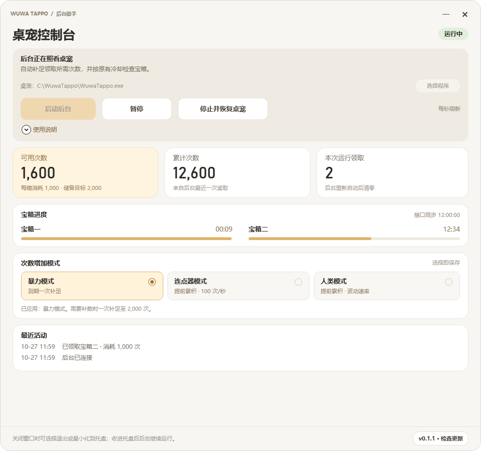

# Wuwa Tappo Helper

Windows 上的 Wuwa Tappo 后台助手，提供次数统计、宝箱倒计时、三种增加模式、最近活动和系统托盘控制。

预览使用模拟数据，不连接桌宠或账号。第三方工具，与库洛无隶属关系；不包含桌宠程序、桌宠资源或账号存档。

## 下载与启动

系统要求：Windows 10 22H2 / Windows 11，64 位，使用系统预装的 .NET Framework 4.8 或兼容更新。请自行安装并登录 Wuwa Tappo。

1. 从 [Releases](https://github.com/kano0222/WuwaTappo-helper/releases) 下载完整分发包，解压到当前用户可写的目录，避免放入 `Program Files` 等受保护目录。
2. 双击 `WuwaTappoHelper.exe`。无需安装 PowerShell 7、Node.js 或 Python。
3. 首次启用前，如果桌宠已普通启动，请从桌宠设置或托盘选择“退出应用”。
4. 在助手中点击“启动后台”，按需允许 Windows 管理员提示。助手会自动查找桌宠；找不到时，点击“选择程序”指定 `WuwaTappo.exe`。面板本身不要求管理员权限。

助手连接时会检查桌宠兼容性。本文描述当前源码行为，下载版本的功能请同时参阅对应的[更新日志](CHANGELOG.md)。

## 模式与宝箱

储备目标为 2,000 次，每箱消耗 1,000 次。三种模式的区别在于何时、以什么速度补充次数；宝箱仍需满足原桌宠的领取条件。

| 模式 | 行为 |
| --- | --- |
| 暴力模式 | 宝箱时间到期且次数不足以领取时，一次补足到储备目标。 |
| 连点器模式 | 提前累积，每批最多 100 次，约每秒一批。 |
| 人类模式 | 提前累积，通常每批 2–7 次，间隔 1–1.5 秒，偶尔间歇 2–4 秒。 |

在面板选择模式即可保存，运行中的后台会随下一轮操作应用。宝箱到期且次数足够时自动领取，两个宝箱依次处理。

宝箱倒计时根据服务器状态同步；查询不要求次数达到 1,000。时间尚未同步时，先等待连接恢复。进度条按 30 分钟范围换算，不代表点击次数。

助手不会修改系统时间、冷却或活跃时长。锁屏、闲置、休眠是否计入活跃时间取决于原桌宠；不能把锁屏与休眠视为相同的运行条件，相关完整恢复流程仍有待实测。

## 暂停、托盘与退出

- **暂停 / 继续**：暂停或恢复自动操作，不重启桌宠。自动核对期间也可点击暂停，核对完成后仍保持暂停；核对尚未完成时不能直接继续。暂停期间仍可同步宝箱时间。
- **停止后台**：断线时显示，仅停止助手后台，不退出或启动桌宠。两种停止都会保留待确认记录。
- **停止并恢复桌宠**：连接正常时显示，请求桌宠正常退出，再以普通方式启动，关闭本次连接使用的本机调试入口。不会强制结束桌宠；恢复失败时按面板提示手动退出桌宠后普通启动。
- **关闭面板**：点击右上角“×”，选择“退出”或“最小化到托盘”；关闭提示框的“×”或按 Esc 可取消。最小化到托盘后后台继续运行，双击托盘图标或再次打开 exe 可唤起面板。
- **退出助手**：也可右键面板空白处或系统托盘图标选择退出。退出会停止新操作并断开连接，不启动或关闭桌宠；已提交的请求无法撤销，未确认记录会保留。本机调试入口会保留到桌宠退出。

同一目录、同一 Windows 用户只运行一个面板和后台。请勿同时从多个目录启动助手。

## 异常与恢复

**连接或状态查询失败**时，助手会等待并自动重试，期间不补数、不领取。断线后会尝试连接现有桌宠，不会自动重启桌宠。持续无法找到调试入口时，按面板提示先点击“停止后台”，再从桌宠菜单正常退出，最后点击“启动后台”。连接和查询恢复后继续核对待确认操作；如果之前手动暂停，仍保持暂停。

如果提示启动配置恢复未完成，后台会停止，不会自动重连后继续操作。请按提示核对启动配置和诊断记录后再启动，不要反复点击启动。

**桌宠更新后**，助手会重新检查接口并同步状态；兼容性检查未通过时等待重试，不继续自动操作。无法连接时，请确认桌宠已登录、所选程序路径正确，并查看面板提示。

**显示“核对中”或操作结果未确认**时，先等待自动核对。助手不会重复发送结果不明的补数或领取；本地保存或查询短暂失败时，会重试能够安全恢复的步骤。确认补数被旧计数上报覆盖后，会按最新计数继续。

切换账号、手动领取、桌宠重启或其他计数变化，可能使上次操作无法自动核实。需要换账号或手动操作时，先暂停助手并等待正在进行的操作核对完成。已有待确认操作时，切换账号不能消除该记录；恢复原账号后也未必能找回核验所需的信息。

**显示“确认并继续”**时，先核对桌宠中的次数和宝箱状态，再点击该按钮。原操作不会重发，原记录会保留；不会清零次数、宝箱进度或日志。后台未运行时，确认后还需点击“启动后台”。不要直接删除记录后重试，以免重复补数或重复领取。

## 本机数据与升级

配置和运行记录保存在助手所在目录。升级或移动程序时，保留 `config.local.json` 和整个 `runtime/`，以保留桌宠路径、所选模式、活动日志和未确认操作。

面板显示最近三条活动。日志持续追加，暂无自动轮转。删除 `runtime/` 会丢失设置、日志和恢复记录，也不能撤销已执行的操作。

助手启动后会自动检查正式版本，也可点击底栏版本按钮手动检查。发现新版后，点击提示打开发布页；检查失败不影响后台运行。助手不会自动下载或覆盖文件。

升级步骤：

1. 如有未确认操作，先核对并妥善处理记录。
2. 完全退出助手及后台。
3. 从 [Releases](https://github.com/kano0222/WuwaTappo-helper/releases) 获取完整新版分发包，替换 `WuwaTappoHelper.exe` 和 `WuwaTappoHelper.exe.config`，保留原有配置和整个 `runtime/`。
4. 重新打开助手，检查模式与桌宠路径，再启动后台。

助手连接使用仅限本机的调试入口，不应将其暴露到网络。助手不设置开机启动或定时任务。

## 使用限制与验证边界

已对桌宠 1.0.2 完成只读接口校验，但这不能证明真实领取和所有恢复场景都已验证。当前接口领取、运行期间升级、锁屏及休眠恢复等完整流程仍需实测；自动测试通过不等于账号操作已通过真实验证。具体记录见[测试与验证说明](https://github.com/kano0222/WuwaTappo-helper/blob/main/docs/TESTING.md)。

库洛用户协议对第三方工具及软件数据操作有限制，技术可用不代表获得官方许可。使用前请自行确认协议和账号风险：[官方用户协议](https://sdk.kurogames.com/pro/agreement/common/language_zh-Hans/terms_of_service)。

## 开发与测试文档

- [开发与本地维护](https://github.com/kano0222/WuwaTappo-helper/blob/main/docs/DEVELOPMENT.md)：构建、版本编号、内部约束、CI、发布及预览生成。
- [测试与验证](https://github.com/kano0222/WuwaTappo-helper/blob/main/docs/TESTING.md)：测试命令、覆盖范围、真实验证记录和未验证场景。
- [更新日志](CHANGELOG.md)：各正式版本的变化。

开发和测试文档保存在仓库中；分发包未附带 `docs/`，请在[项目仓库](https://github.com/kano0222/WuwaTappo-helper)中查看。
