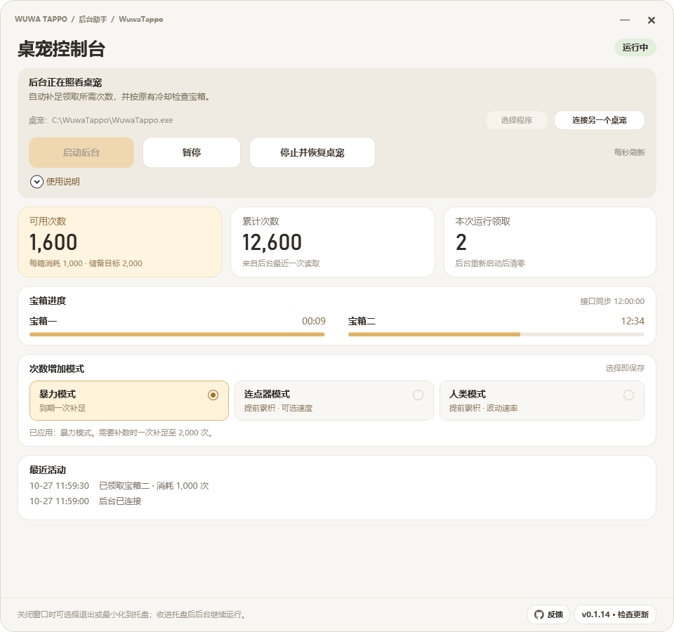

# Wuwa Tappo Helper

  
  
  

Windows 上的 Wuwa Tappo 后台助手，支持国服与国际服，提供次数统计、宝箱倒计时、三种增加模式和系统托盘控制。

预览使用模拟数据，不连接账号。第三方工具，与库洛无隶属关系；不包含桌宠程序、资源或账号存档。

本文是使用指南。开发维护见[开发文档](https://github.com/kano0222/WuwaTappo-helper/blob/main/docs/DEVELOPMENT.md)，验证范围见[测试文档](https://github.com/kano0222/WuwaTappo-helper/blob/main/docs/TESTING.md)。当前源码可能包含未发布功能，下载版本以[更新日志](https://github.com/kano0222/WuwaTappo-helper/blob/main/CHANGELOG.md)为准。

## 下载与启动

系统要求：Windows 10 22H2 / Windows 11，64 位，.NET Framework 4.8 或兼容更新。无需安装 PowerShell 7、Node.js 或 Python。请先自行安装并登录 Wuwa Tappo。

1. 从 [Releases](https://github.com/kano0222/WuwaTappo-helper/releases) 下载完整分发包，解压到当前用户可写的目录，避免放入 `Program Files` 等受保护目录。
2. 双击 `WuwaTappoHelper.exe`。助手会自动查找桌宠，也可点击“选择程序”指定安装目录中的 `WuwaTappo.exe`。
3. 首次启用时，若桌宠已普通启动，请从桌宠设置或托盘正常退出该桌宠。
4. 点击“启动后台”，按需允许管理员提示。面板本身不要求管理员权限。

助手会检查桌宠接口，未知版本也会尝试连接；校验不通过时暂停自动操作。登录失效时，请在桌宠内重新登录。

## 国服与国际服双开

从 v0.1.14 起支持国服与国际服同时托管，一个助手窗口绑定一个桌宠。

点击“连接另一个桌宠”，选择另一服的 `WuwaTappo.exe`（国际服通常位于 `WuwaTappoGlobal`），即可打开独立窗口。再次选择已绑定的程序，会唤起对应窗口；重复打开助手 exe 则唤起默认窗口。

两个窗口分别启动后台、设置模式、暂停和恢复；根据窗口标题、程序路径和托盘提示区分。使用同一份助手即可，无需复制目录。同一个桌宠只允许一个新版助手后台接管，升级试用前请先退出旧版助手。

另一服已普通启动但无法连接时，正常退出该桌宠，再点击对应窗口的“启动后台”；无需退出已连接的另一服。

## 模式与宝箱

| 模式 | 行为 |
| --- | --- |
| 暴力模式 | 宝箱到期且次数不足时，一次补足至 2,000 次。 |
| 连点器模式 | 提前累积，可选 100 / 500 / 1,000 次/秒；实际速度受操作确认耗时影响。 |
| 人类模式 | 提前累积，采用较小批次和不固定的间隔。 |

连点器和人类模式共用储备目标，可选 2,000 / 5,000 / 10,000 / 20,000 / 50,000 次，默认 2,000。选择即保存，后台随下一轮操作应用。最后一批会完整执行，因此次数可能略超目标；调低目标不会扣除已有次数。

每箱消耗 1,000 次。满足原桌宠领取条件后自动领取，两个宝箱依次处理。倒计时根据服务器状态同步，时间尚未同步时请等待连接恢复。

## 暂停与退出

| 操作 | 效果 |
| --- | --- |
| 暂停 / 继续 | 暂停或恢复自动操作，保留连接；暂停期间仍可同步宝箱时间。 |
| 停止后台 | 断线时显示，只停止助手后台，不退出或启动桌宠。 |
| 停止并恢复桌宠 | 请求所选桌宠正常退出，再以普通方式启动，关闭调试入口；不会强制结束桌宠。 |
| 最小化到托盘 | 隐藏窗口，后台继续运行；双击对应托盘图标可唤起窗口。 |
| 退出助手 | 停止该窗口的后台并断开连接，不关闭桌宠；调试入口保留到桌宠退出。 |

右上角“×”可选择退出或最小化到托盘。停止或退出不会撤销已提交的操作，待确认记录会保留。

## 遇到异常时

- **连接失败或等待重试**：助手会自动重试，期间不补数、不领取。网络恢复后可点“立即重试”；服务器要求的等待时间不能跳过。持续无法连接时，先停止对应后台，正常退出该桌宠，再点击“启动后台”。
- **核对中或结果未确认**：等待自动核对，助手不会重发结果不明的操作。可以暂停，让核对完成后仍保持暂停；有待确认记录时不能直接继续。
- **确认并继续**：先核对桌宠中的次数和宝箱状态，再点击按钮。原记录会保留，原操作不会重发；后台未运行时还需点击“启动后台”。不要删除记录后重试。
- **桌宠更新后无法连接**：确认已登录、程序路径正确，并按面板提示处理。助手会重新检查接口，兼容性检查通过前不继续自动操作。
- **启动诊断保存失败**：检查助手目录及 `runtime/` 的写入权限，再启动后台。

换账号或手动领取前，请先暂停助手并等待正在进行的操作核对完成。切换账号、重启桌宠等变化可能使原操作无法自动核实。

## 数据与升级

配置和运行记录保存在助手所在目录。升级或移动时，保留 **`config.local.json` 和整个 `runtime/`**，其中包含所有实例的路径、设置、日志和待确认记录。删除这些数据不能撤销已执行的操作。

1. 如有未确认操作，先核对并妥善处理。
2. 完全退出所有助手窗口及后台。
3. 下载新版，替换 `WuwaTappoHelper.exe` 和 `WuwaTappoHelper.exe.config`，保留上述配置和数据。
4. 重新打开助手，检查各实例的路径和设置，再启动后台。

助手会检查正式版本，发现新版后提供发布页入口，不会自动下载或覆盖文件。底栏版本按钮也可手动检查。

## 限制与反馈

助手不修改系统时间、冷却或活跃时长，不设置开机启动。锁屏、闲置、休眠是否计入活跃时间取决于原桌宠；相关恢复流程和完整账号操作的验证边界见[测试文档](https://github.com/kano0222/WuwaTappo-helper/blob/main/docs/TESTING.md)。调试入口仅供本机连接，不应暴露到网络。

库洛用户协议对第三方工具及软件数据操作有限制，技术可用不代表获得官方许可。使用前请自行确认协议和账号风险：[官方用户协议](https://sdk.kurogames.com/pro/agreement/common/language_zh-Hans/terms_of_service)。

通过底栏“反馈”或 [GitHub Issues](https://github.com/kano0222/WuwaTappo-helper/issues) 提交问题，请附助手和桌宠版本、所用服务器、操作步骤、实际结果及脱敏截图；不要提供账号令牌或完整运行目录。
