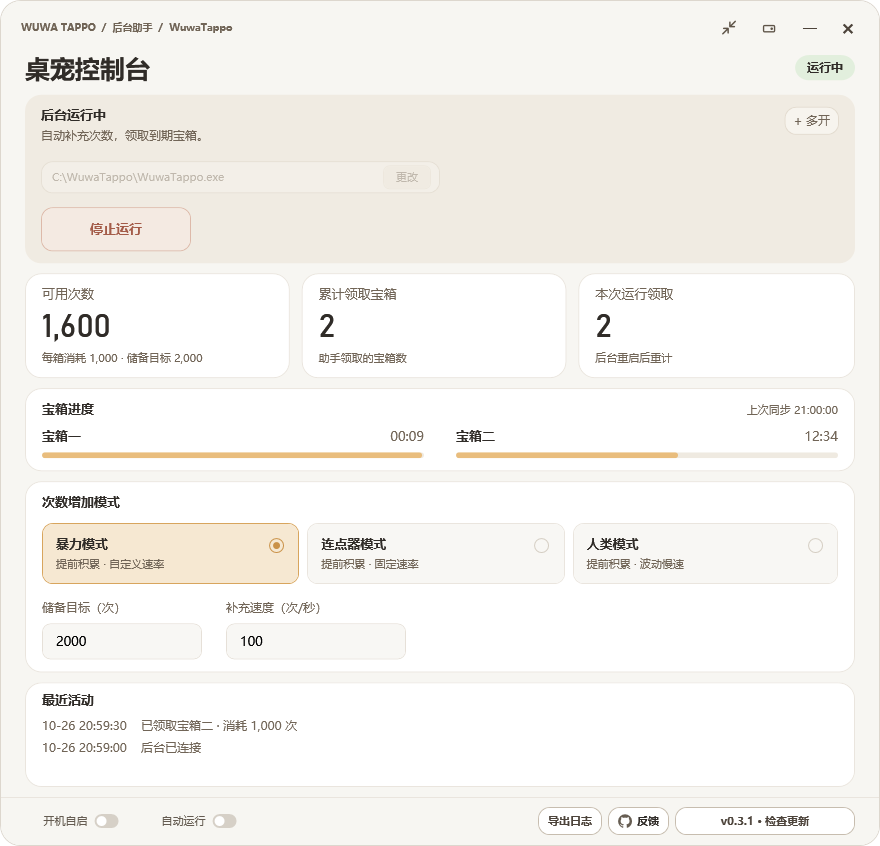
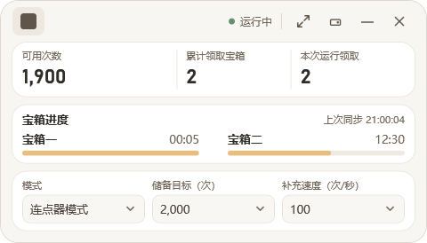

# Wuwa Tappo Helper

  
  
  
  

Windows 上的 Wuwa Tappo 第三方后台助手，支持国服与国际服，可自动补充次数、领取宝箱并显示冷却进度。使用前请了解[官方用户协议](https://sdk.kurogames.com/pro/agreement/common/language_zh-Hans/terms_of_service)及账号风险。

## 下载与首次启动

1. 在 Windows 10 22H2 或 Windows 11（64 位，.NET Framework 4.8）上安装并登录桌宠。从 [Releases](https://github.com/kano0222/WuwaTappo-helper/releases) 下载 `WuwaTappoHelper-win-x64.zip`，解压到当前用户可写的目录。
2. 双击 `WuwaTappoHelper.exe`。助手会查找桌宠，也可用“选择程序”指定 `WuwaTappo.exe`。首次使用助手时，如果桌宠已经打开，请先从桌宠设置或托盘正常退出。
3. 点击“启动后台”，按需确认 Windows 管理员提示。连接成功后即可在面板查看次数和宝箱进度。

**双服同时运行**时，用同一份助手点击“+ 多开”，选择另一服的 `WuwaTappo.exe`。每个窗口独立启动后台、保存设置；再次选择已绑定的程序会唤起对应窗口。

## 日常使用

**完整面板**可选择模式、查看最近活动和导出日志。**迷你模式**保留启停、统计、宝箱进度和次数设置。点击标题栏的收缩或展开图标切换，下次打开时恢复上次的视图。

图片无法显示时，可前往[Github项目主页](https://github.com/kano0222/WuwaTappo-helper#readme)查看。

### 次数与宝箱

| 模式 | 补充方式 | 可调参数 |
| --- | --- | --- |
| 暴力模式 | 按设定速度提前累积 | 储备目标 1,000～99,999,999 次，速度 1～2,000 次/秒 |
| 连点器模式 | 按固定批次提前累积 | 速度可选 100、500 或 1,000 次/秒 |
| 人类模式 | 采用较小批次，间隔有波动 | 与连点器模式共用储备目标 |

连点器和人类模式的储备目标可选 2,000、5,000、10,000、20,000 或 50,000 次，默认 2,000。有效设置即时保存，后台下一轮应用。每批完整执行，实际速度受确认耗时影响，次数可能略超目标。

每箱消耗 1,000 次，满足桌宠领取条件后自动领取。两箱都到期时依次处理。“已领取 · 确认中”表示已收到成功回执，助手还在核对到账结果。

### 窗口与后台

| 操作 | 效果 |
| --- | --- |
| 停止运行 | 暂停自动操作，保留桌宠和连接。点击“启动后台”继续。 |
| 收起到托盘 | 隐藏该窗口，后台继续运行。双击对应的托盘图标唤回。 |
| 退出助手 | 停止该窗口的后台并断开连接，桌宠保持运行。标题栏“×”可选择退出或收起。 |

在完整面板底部或托盘菜单开启“开机自启”，可在登录 Windows 时打开助手；开启“自动运行”，可在窗口打开时启动后台。两项默认关闭，按实例保存。

## 异常处理

- **连接失败或等待重试。** 检查桌宠登录状态和程序路径。助手会自动重试；持续失败时停止对应后台，正常退出该桌宠，再点“启动后台”。服务器要求的等待时间仍然有效。若提示启动诊断保存失败，检查助手目录的写入权限。
- **领取或补充结果待确认。** 等待自动核对。面板要求“确认并继续”时，先在桌宠核对次数、宝箱和奖励，再确认；后台已退出时再点“启动后台”。保留待确认记录可防止重发。切号或手动领取前，先暂停并等待在途操作核对完成。两边倒计时显示不一致时，以助手的最终确认记录核对领取结果。
- **状态长时间不更新或操作超时。** 在完整面板点击“导出日志”，通过“反馈”或 [GitHub Issues](https://github.com/kano0222/WuwaTappo-helper/issues) 提交 ZIP，并注明桌宠版本、国服或国际服、操作步骤和实际现象。

## 升级与数据

在完整面板底部点击“检查更新”。发现新版后选择“下载新版”，校验完成后点击“重启更新”。助手会等待当前操作结束，替换程序文件并重开原先打开的窗口。开启“自动运行”的实例在满足启动条件时会启动后台。

手动升级前先处理待确认操作，退出所有助手窗口及后台。用新版分发文件替换旧文件，**保留 `config.local.json` 和整个 `runtime/`**，其中保存各实例的配置、历史和待确认记录。移动助手目录时，先关闭“开机自启”，再在新位置启用。

[更新日志](https://github.com/kano0222/WuwaTappo-helper/blob/main/CHANGELOG.md) · [开发文档](https://github.com/kano0222/WuwaTappo-helper/blob/main/docs/DEVELOPMENT.md) · [测试与验收](https://github.com/kano0222/WuwaTappo-helper/blob/main/docs/TESTING.md)
